# AIBox

**跨平台本地 AI 模型工作台 · 语音 · 语言 · 图像 · 视频 · 音轨分离**

AIBox 把模型下载、硬件探测、推理后端和生成工作流放进同一个 Fluent 设计的工作台。模型与音频保存在本机，转写完成后可直接导出 SRT / VTT / TXT / JSON，语音合成可导出 WAV / MP3 / FLAC 等格式，图像可预览与下载，视频可生成 MP4，歌曲可分轨。

当前版本同时支持 **ASR（Whisper）**、**TTS（IndexTTS）**、**大语言模型（GGUF / OpenAI 兼容）**、**图像生成（SD / SDXL / FLUX / Qwen-Image / ComfyUI）**、**视频生成（MiniMax H3 / Hailuo / ComfyUI）** 与 **人声/伴奏分离（Demucs / UVR MDX）**：模型库、下载队列、CPU / NVIDIA CUDA 推理、转写/合成/对话/绘图/视频/分离工作台、任务与结果、对外 OpenAI HTTP、WebSocket、gRPC 与 MRCPv2 接入；并提供多模型驻留的弹性调度。社区可用声明式适配器接入 FunASR、Moonshine、Piper、Kokoro、CosyVoice、F5-TTS 等模型，无需修改 AIBox 源码。NPU 已完成设备发现与能力编排，Whisper / IndexTTS 的 NPU 加速接入在路线图中；Android / iOS 只做规划，不在本仓库执行。

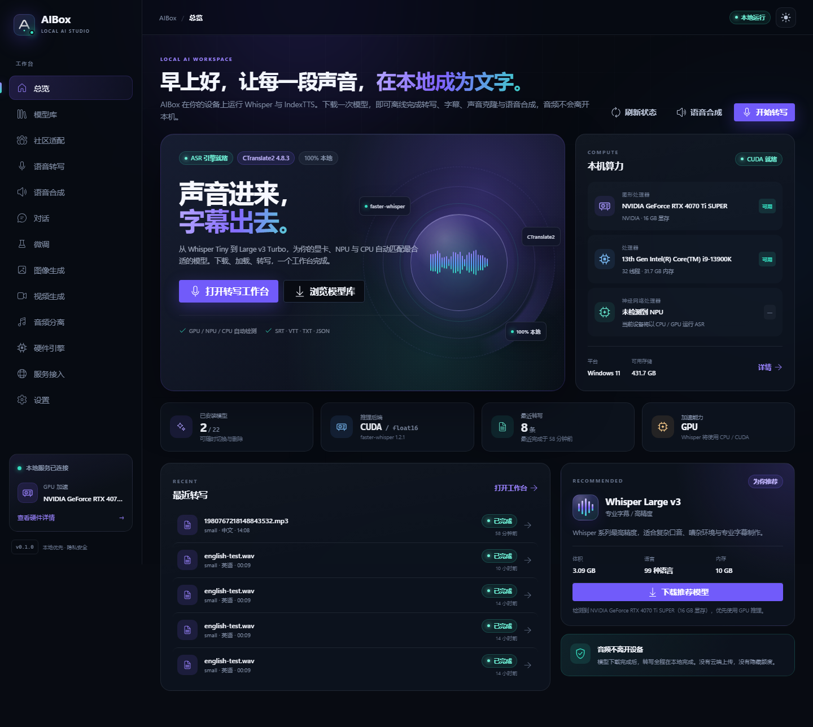

## 功能

- **Fluent WebUI**：Windows、macOS、Linux 与服务器统一界面，响应式适配移动浏览器。
- **本地桌面 UI**：Windows / macOS 使用 Tauri WebView 承载同一套 Fluent WebUI；Linux 按需求仅提供 WebUI。
- **硬件探测**：CPU、NVIDIA GPU、AMD / Intel / Apple GPU、NPU 设备与驱动状态真实探测。
- **Whisper 模型库**：Tiny / Base / Small / Medium / Large v3 / Large v3 Turbo / Distil Large v3。
- **IndexTTS 模型库**：IndexTTS 2.5 / IndexTTS 2，支持零样本音色克隆、多语言、情绪与语速控制（以模型能力为准）。
- **图像模型库**：Stable Diffusion 1.5 / SDXL、FLUX.1 schnell / dev、Qwen-Image；支持本地 Diffusers worker 与 ComfyUI 外部运行。
- **图像工作流**：默认只暴露提示词、比例、模型与数量；步数、种子、ComfyUI checkpoint / 工作流放在“高级设置”，默认不展示节点图。
- **人声 / 伴奏分离**：Demucs v4 / htdemucs_ft / MDX Extra 与 UVR MDX-Net，支持去人声、去背景、四轨分离；分轨可试听与下载。
- **视频生成**：MiniMax H3 / Hailuo 02 云端 API，以及 ComfyUI 的 Wan2.1 / HunyuanVideo / LTX-Video；默认只展示提示词、时长、分辨率与画幅，节点图放在高级设置。
- **语言模型**：本地 GGUF（Qwen / Llama / Mistral / Gemma / DeepSeek / Phi）通过 llama-server 运行，也可连接 Ollama / LM Studio / vLLM / 任意 OpenAI 兼容服务；流式对话与 OpenAI `/v1/chat/completions`。
- **模型管理**：Hugging Face 下载、分文件进度、速度 / ETA、取消、完整性校验、安装 manifest、删除、设为默认。
- **多种加载**：已安装模型可在转写 / 合成页即时切换；ASR 与 TTS 可同时驻留，弹性调度按显存 / 内存与需求换入换出。
- **弹性模式**：自动、均衡、ASR 优先、TTS 优先、时间片、自定义；可配置空闲卸载、切换窗口、常驻上限、显存 / 内存预留与固定驻留类型。
- **多设备与并行**：设备池、ASR 数据并行、llama.cpp 张量 / 流水切分；支持 `auto` / `single` / `data` / `tensor` / `pipeline` / `hybrid` 策略。
- **模型微调管理**：数据集上传校验、QLoRA / LoRA / 全量微调任务、训练日志、取消与产物下载；真实训练通过外部命令或演示运行器。
- **社区适配**：声明式 `openai-http` / `command` 适配器，覆盖 FunASR、Moonshine、Piper、Kokoro、CosyVoice、F5-TTS、GPT-SoVITS、Fish Speech 等主流模型；内置 16 个配方模板，导入后默认停用。
- **真实推理**：faster-whisper + CTranslate2（CPU / CUDA）；IndexTTS 通过独立 Python worker 加载，避免依赖冲突。
- **转写工作台**：拖放音频、自动语言检测、VAD、beam size、词级时间戳、实时进度、取消任务。
- **合成工作台**：文本、参考音色、语言、语速、输出格式；支持上传自定义参考音与历史结果试听。
- **结果处理**：全文 / 分段视图、播放器与时间轴联动、复制全文、四种字幕格式导出、历史记录。
- **外部 ASR 服务**：OpenAI `/v1/audio/transcriptions`、WebSocket 流式音频、gRPC Unary / Streaming、MRCPv2 `speechrecog` 最小实现；统一任务队列、可选 Bearer Token。
- **外部 TTS 服务**：OpenAI `/v1/audio/speech`、本地 `/api/tts/synthesize`、gRPC `aibox.tts.v1.TtsService`。
- **外部图像服务**：OpenAI `/v1/images/generations`、本地 `/api/images/generations`，支持 `url` / `b64_json`。
- **隐私优先**：所有数据在本地；删除记录时同步清理音频，可配置转写后不保留源音频。
- **移动端规划**：Android / iOS 的容器、推理、下载、热管理与合规边界见 [移动端规划](docs/mobile-plan.md)，不含执行代码。

## 外部服务

| 协议 | 默认端点 | 认证 | 文档 |
| --- | --- | --- | --- |
| OpenAI ASR | `http://127.0.0.1:8765/v1/audio/transcriptions` | Bearer Token（可选） | [OpenAI](docs/transports.md#openai-兼容-http) |
| OpenAI TTS | `http://127.0.0.1:8765/v1/audio/speech` | Bearer Token（可选） | [OpenAI TTS](docs/transports.md#openai-tts) |
| OpenAI Images | `http://127.0.0.1:8765/v1/images/generations` | Bearer Token（可选） | [图像生成](docs/images.md) |
| WebSocket | `ws://127.0.0.1:8765/ws/asr` | Bearer / `?token=`（可选） | [WebSocket](docs/transports.md#websocket) |
| gRPC | `127.0.0.1:50051` · `aibox.asr.v1.AsrService` · `aibox.tts.v1.TtsService` | Bearer metadata（可选） | [gRPC](docs/transports.md#grpc) |
| MRCPv2 | SIP `8060/udp` · 控制 `8061/tcp` · RTP `50000-50100/udp` | 无内置认证 | [MRCPv2](docs/transports.md#mrcpv2) |

设置 `AIBOX_API_TOKEN` 后，OpenAI / WebSocket / gRPC 需要 Bearer Token；本地 WebUI 的 `/api/*` 不受影响。MRCP 需通过 SBC / 防火墙 / 可信内网限制来源。

## 界面

| 模型库 | 转写结果 |
| --- | --- |
| 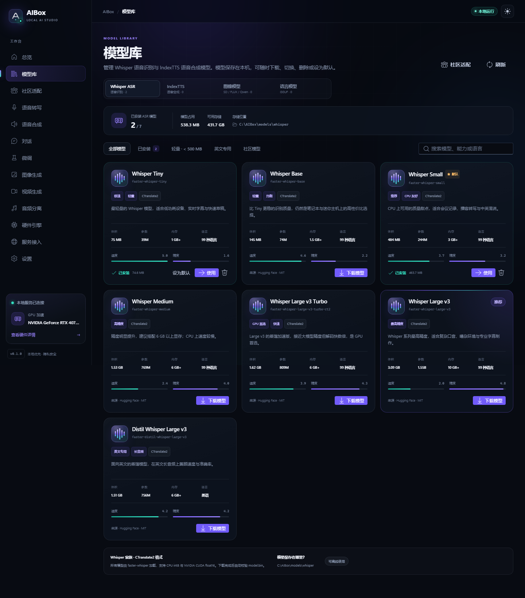 | 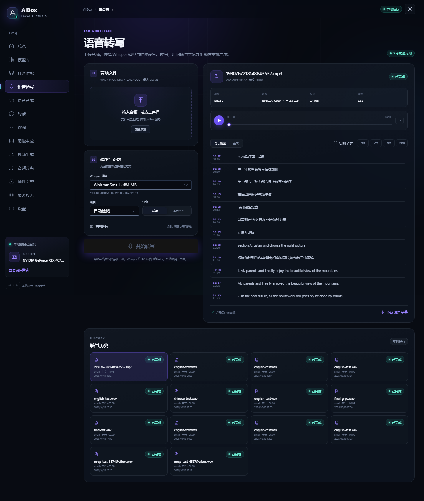 |

| 语音合成 | 图像生成 |
| --- | --- |
| 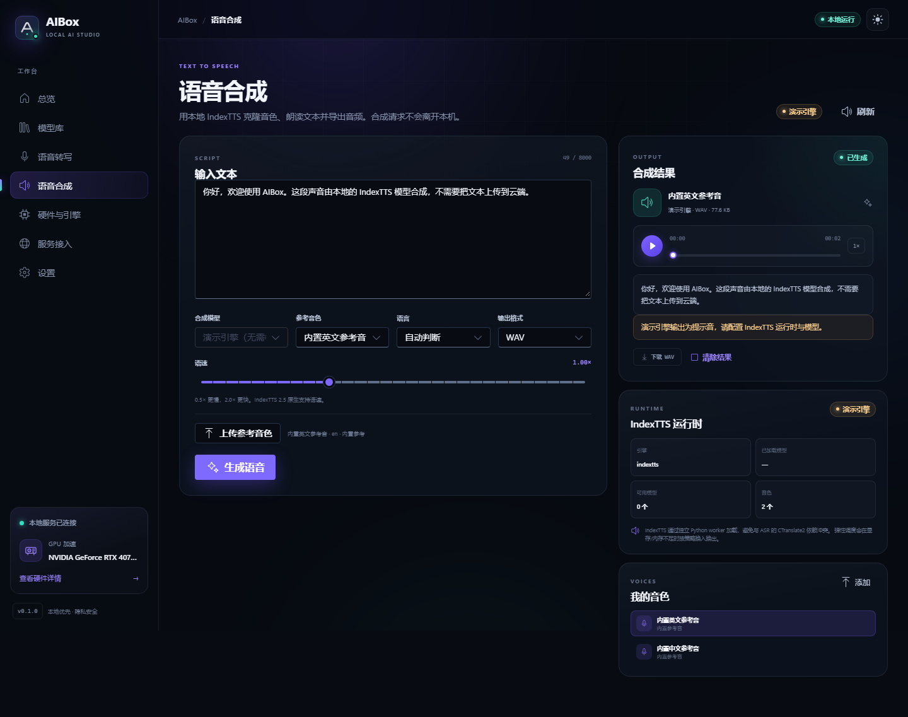 | 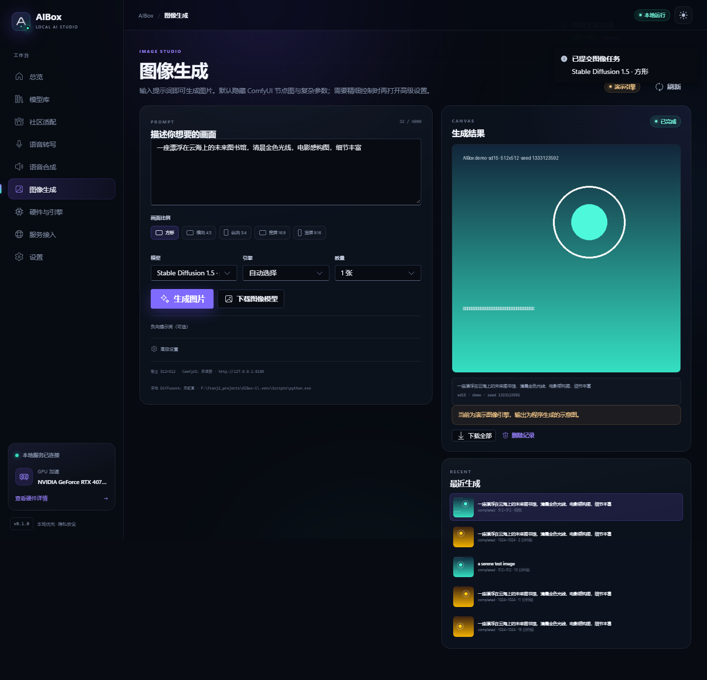 |

| 人声分离 |
| --- |
| 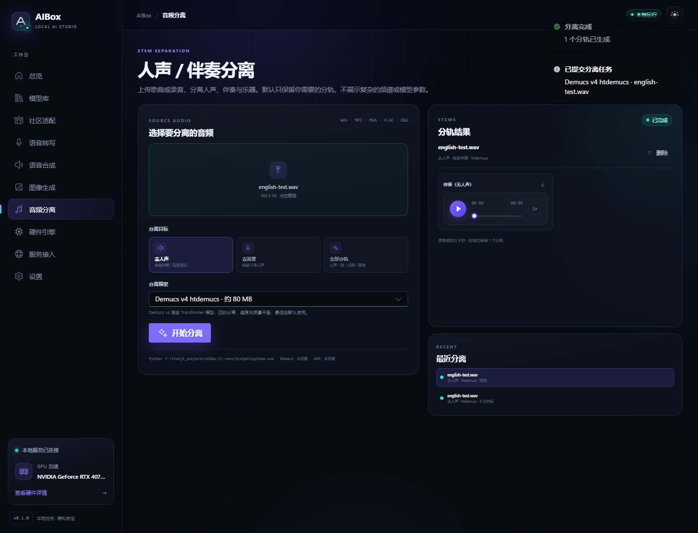 |

| 视频生成 |
| --- |
| 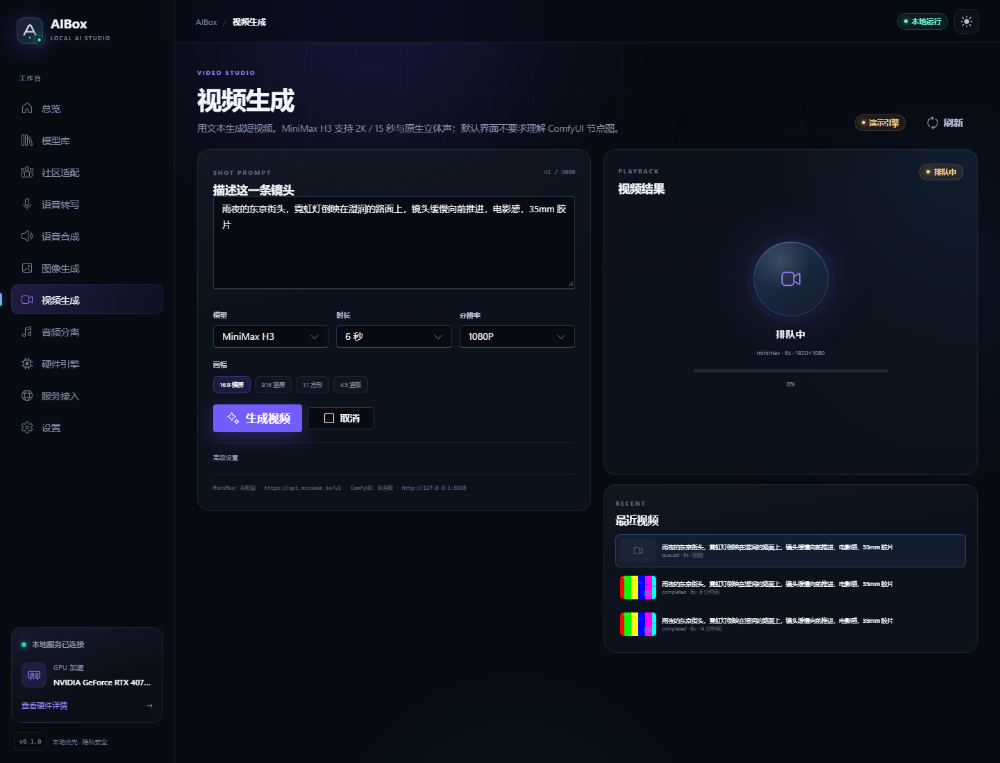 |

| 语言模型 |
| --- |
| 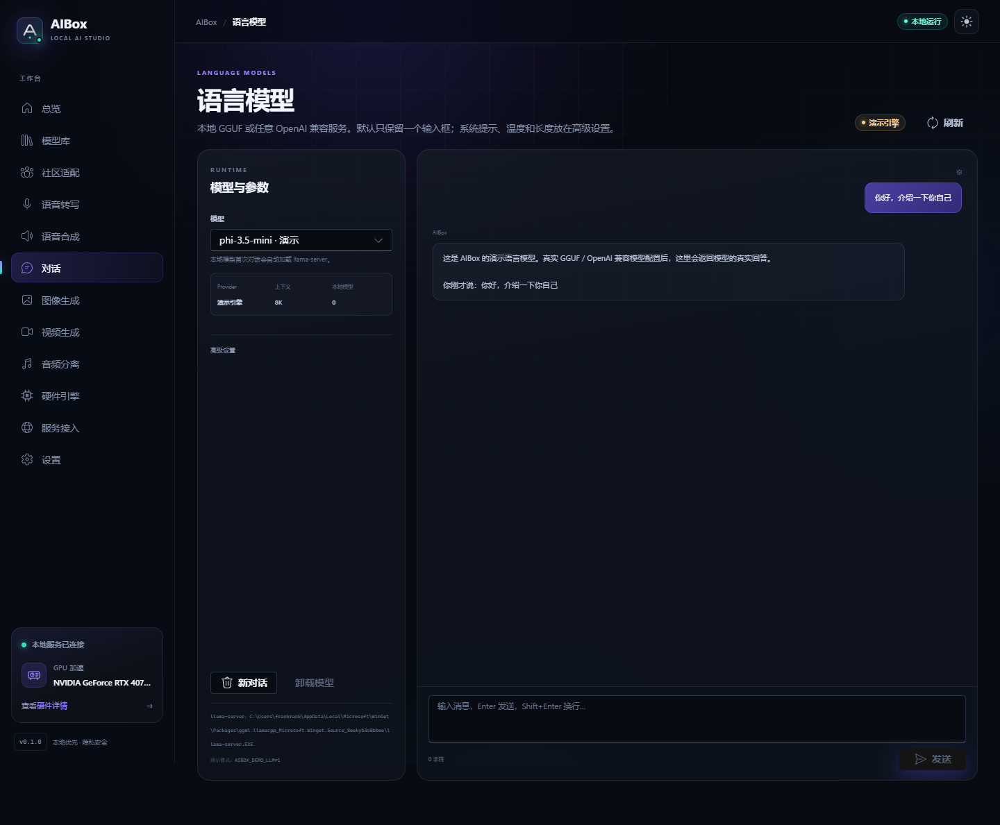 |

| 模型微调 |
| --- |
| 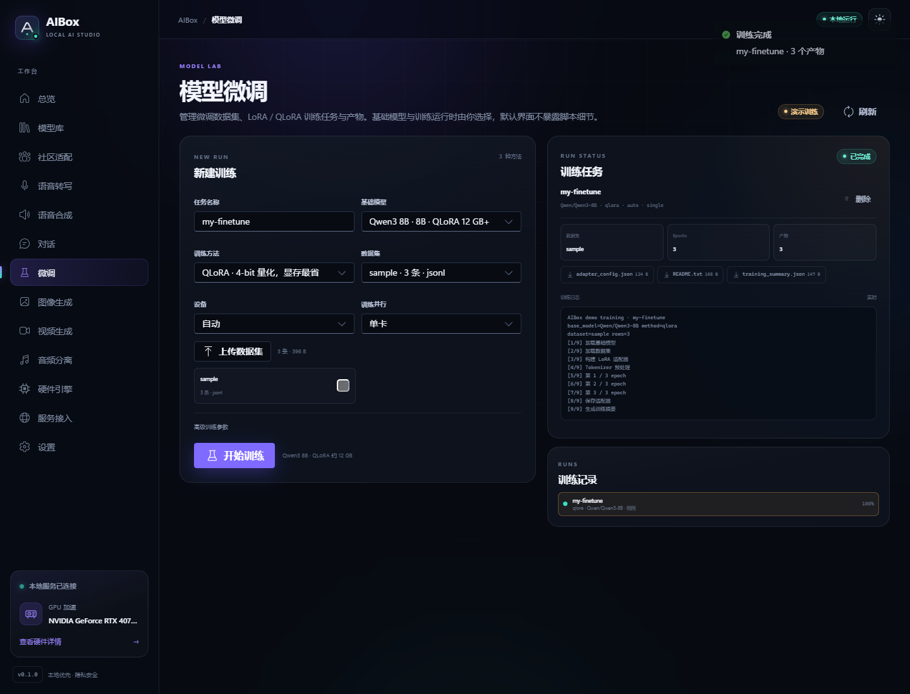 |

| 社区适配 |
| --- |
| 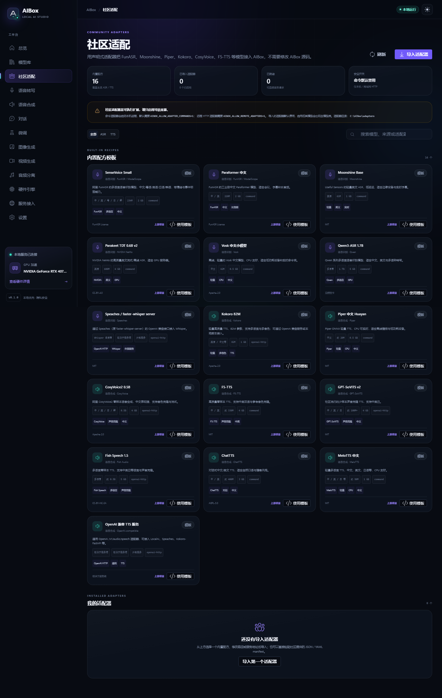 |

| 弹性调度 | 图像模型库 |
| --- | --- |
| 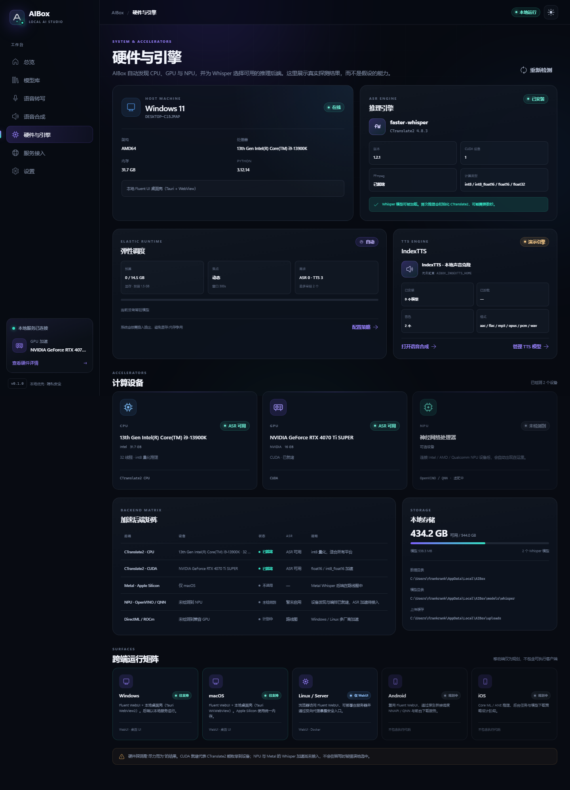 | 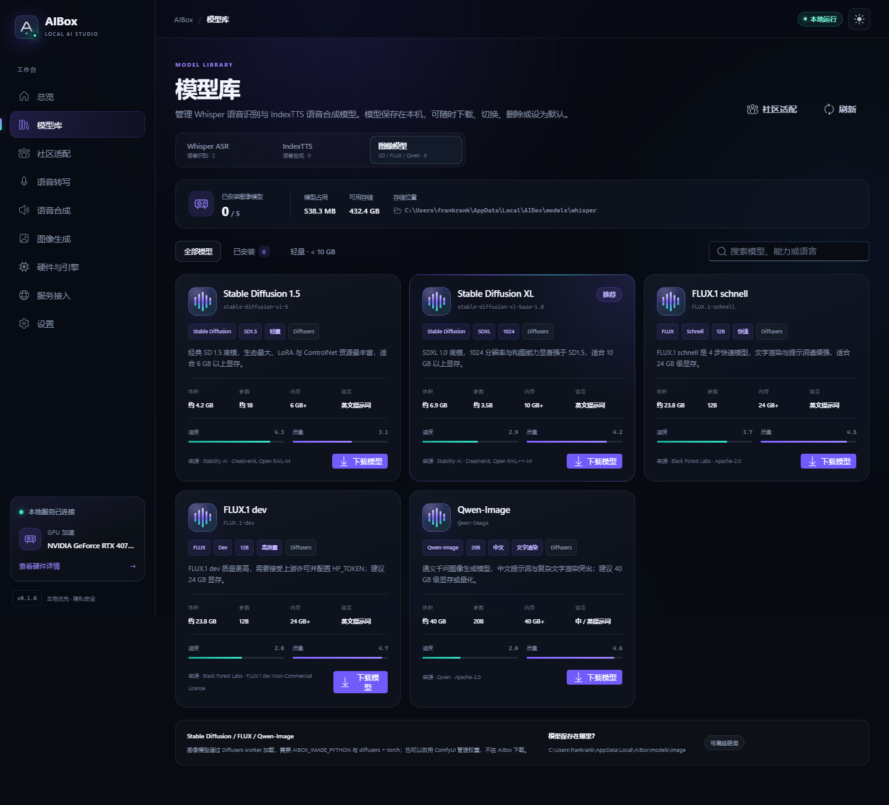 |

| 硬件与引擎 | 服务接入 |
| --- | --- |
| 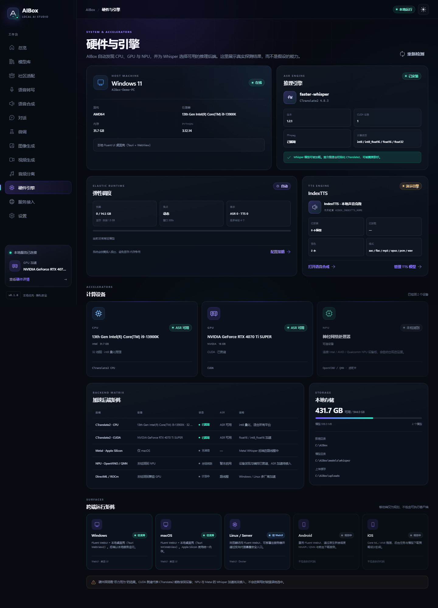 | 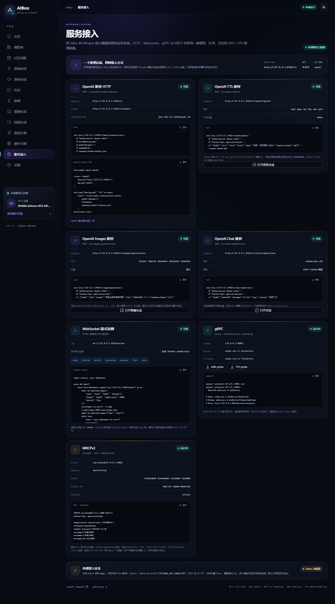 |

| 移动端 WebUI |
| --- |
| 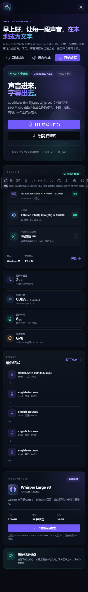 |

更多截图位于 [`screenshots/`](screenshots/)：图像生成结果、图像模型库、TTS 合成结果、IndexTTS 模型库、社区适配、上传态、空状态、路线图、设置页、浅色主题、服务接入与 390px 移动端页面。

## 平台状态

| 平台 | WebUI | 本地 UI | 状态 |
| --- | --- | --- | --- |
| Windows 10/11 | Fluent WebUI | Tauri + WebView2 | 已实现 / 已验证 WebUI 与 API |
| macOS 12+ | Fluent WebUI | Tauri + WKWebView | 已实现，需在 macOS 上构建桌面壳 |
| Linux / Server | Fluent WebUI | 仅 WebUI | 已实现，支持 Docker |
| Android | 规划中 | 规划中 | **仅规划** |
| iOS | 规划中 | 规划中 | **仅规划** |

> 桌面安装包需要在目标平台本地构建：`scripts/build-sidecar.ps1` → `pnpm --filter @aibox/desktop build`。仓库不附带预编译安装包。

## 快速开始

### 环境

- Python 3.10+（推荐 3.12）
- Node.js 20+ 与 pnpm 10+
- FFmpeg（可选；PyAV 已覆盖常见格式，但安装 ffmpeg 更稳）
- NVIDIA GPU 可选：驱动 + CUDA 12。推荐安装 pip 版 cuBLAS / cuDNN：`setup --cuda`
- 桌面壳：Rust 1.90+（`rust-toolchain.toml` 固定）、Windows WebView2 / macOS WKWebView

### Windows

```powershell
powershell -ExecutionPolicy Bypass -File scripts/setup.ps1
# 可选：启用 NVIDIA GPU 运行时
powershell -ExecutionPolicy Bypass -File scripts/setup.ps1 --cuda

# 开发模式（Vite + API）
powershell -ExecutionPolicy Bypass -File scripts/dev.ps1

# 生产模式（构建 WebUI 并由 API 同源提供）
powershell -ExecutionPolicy Bypass -File scripts/start.ps1
```

打开 <http://127.0.0.1:8765>。首次进入「模型库」下载一个 Whisper 或 IndexTTS 模型，然后在「语音转写」拖入音频，或在「语音合成」输入文本。外部协议状态与示例在「服务接入」页面查看。

IndexTTS 需要单独的重型运行时；如果只想先验证 TTS 界面与 OpenAI `/v1/audio/speech`：

```powershell
$env:AIBOX_DEMO_TTS="1"
.\.venv\Scripts\python.exe -m aibox_api --host 127.0.0.1 --port 8765
```

真实 IndexTTS：

```powershell
powershell -ExecutionPolicy Bypass -File scripts/setup-indextts.ps1
$env:AIBOX_INDEXTTS_HOME="F:\path\to\index-tts"
$env:AIBOX_INDEXTTS_PYTHON="F:\path\to\index-tts\.venv\Scripts\python.exe"
```

然后在模型库的 IndexTTS 页签下载对应权重。

图像生成可以先用演示引擎验证界面和 OpenAI Images：

```powershell
$env:AIBOX_DEMO_IMAGE="1"
.\.venv\Scripts\python.exe -m aibox_api --host 127.0.0.1 --port 8765
```

真实 SD / FLUX / Qwen-Image 可安装 Diffusers 运行时并设置 `AIBOX_IMAGE_PYTHON`，或直接连接 ComfyUI（`AIBOX_COMFYUI_URL`）。详见 [图像生成](docs/images.md)。

人声/伴奏分离的演示引擎：

```powershell
$env:AIBOX_DEMO_SEPARATION="1"
.\.venv\Scripts\python.exe -m aibox_api --host 127.0.0.1 --port 8765
```

真实 Demucs / UVR 运行时与模型配置见 [人声/伴奏分离](docs/separation.md)。

视频生成演示：

```powershell
$env:AIBOX_DEMO_VIDEO="1"
.\.venv\Scripts\python.exe -m aibox_api --host 127.0.0.1 --port 8765
```

真实 MiniMax H3 需要 `MINIMAX_API_KEY`；本地视频使用 ComfyUI workflow。详见 [视频生成](docs/video.md)。

语言模型演示：

```powershell
$env:AIBOX_DEMO_LLM="1"
.\.venv\Scripts\python.exe -m aibox_api --host 127.0.0.1 --port 8765
```

真实本地 GGUF 需要 `llama-server`；外部服务使用 `AIBOX_LLM_BASE_URL`。详见 [大语言模型](docs/llm.md)。

### macOS / Linux

```bash
./scripts/setup.sh
# 可选 GPU（Linux + NVIDIA CUDA 12）
./scripts/setup.sh --cuda

./scripts/dev.sh
# 或
./scripts/start.sh
```

macOS 的桌面壳在 macOS 上构建：

```bash
./scripts/build-sidecar.sh
pnpm --filter @aibox/desktop build
```

### 手动启动

```powershell
.\.venv\Scripts\python.exe -m aibox_api --host 127.0.0.1 --port 8765 --open
```

```bash
.venv/bin/python -m aibox_api --host 127.0.0.1 --port 8765 --open
```

开发时前端单独运行：

```bash
pnpm dev:web        # http://127.0.0.1:5173
```

Vite 会把 `/api` 代理到 `127.0.0.1:8765`。

## 桌面 UI

Windows / macOS 的 Tauri 壳位于 [`apps/desktop`](apps/desktop)，它：

1. 加载同一套 Fluent WebUI；
2. 启动时检测 `127.0.0.1:8765`，未运行时自动拉起本地 API；
3. 开发态使用仓库 `.venv` 的 Python；
4. 发布态使用 PyInstaller 构建的 `aibox-server` sidecar；
5. 退出时结束自己启动的后端进程。

开发桌面前端：

```powershell
powershell -ExecutionPolicy Bypass -File scripts/dev-desktop.ps1
```

构建安装包：

```powershell
powershell -ExecutionPolicy Bypass -File scripts/build-sidecar.ps1
pnpm --filter @aibox/desktop build
```

Linux 不构建 Tauri 桌面壳，仅发布 WebUI / Docker 服务，符合当前产品范围。详细构建、sidecar 约定与排障见 [桌面壳文档](docs/desktop.md)。

## 服务器部署

```bash
docker compose up -d --build
```

打开 <http://服务器IP:8765>。数据持久化在 `aibox-data` volume。

NVIDIA GPU 服务器（需安装 NVIDIA Container Toolkit）：

```bash
docker compose -f docker-compose.gpu.yml up -d --build
```

镜像内会安装 `nvidia-cublas-cu12`、`nvidia-cudnn-cu12` 等 CUDA 用户态库，运行时把 GPU 透传给容器。

默认只监听 `127.0.0.1`。Docker 中使用 `AIBOX_HOST=0.0.0.0`。公网部署前请加反向代理和鉴权，参考 [部署文档](docs/deployment.md)。

## 模型

| 模型 | 体积 | 参数 | 建议 | 语言 |
| --- | --- | --- | --- | --- |
| Whisper Tiny | 75 MB | 39M | 低功耗 / 实时草稿 | 99 |
| Whisper Base | 145 MB | 74M | 日常语音笔记 | 99 |
| Whisper Small | 484 MB | 244M | CPU 质量甜点 | 99 |
| Whisper Medium | 1.53 GB | 769M | GPU 会议 / 访谈 | 99 |
| Whisper Large v3 Turbo | 1.62 GB | 809M | GPU 实时转写，速度优先 | 99 |
| Whisper Large v3 | 3.09 GB | 1.55B | 复杂口音 / 专业字幕 | 99 |
| Distil Whisper Large v3 | 1.51 GB | 756M | 英文长音频 | 英语 |

模型均为 CTranslate2 格式，由 faster-whisper 加载。下载源为 Hugging Face；支持 `HF_TOKEN` 和 `AIBOX_HF_ENDPOINT` 镜像。

### IndexTTS

| 模型 | 体积 | 语言 | 建议 | 说明 |
| --- | --- | --- | --- | --- |
| IndexTTS 2.5 | 5.11 GB | 中 / 英 / 日 / 西 / 阿 | 多语言配音首选 | 最新版，音色克隆 + 情绪 + 语速 |
| IndexTTS 2 | 5.49 GB | 中 / 英 | 稳定兼容 | 零样本音色克隆、跨语言 |

IndexTTS 通过独立 Python worker 加载，运行时由 `scripts/setup-indextts.ps1` 安装。模型下载后保存在 `models/tts/`，不会与 Whisper 的 CTranslate2 依赖混装。

### 图像模型

| 模型 | 体积 | 建议显存 | 说明 |
| --- | --- | --- | --- |
| Stable Diffusion 1.5 | 约 4.2 GB | 6 GB+ | 生态最大，LoRA / ControlNet 资源丰富 |
| SDXL | 约 6.9 GB | 10 GB+ | 1024 分辨率与构图能力更强 |
| FLUX.1 schnell | 约 23.8 GB | 20 GB+ | 4 步快速生成，文字渲染强 |
| FLUX.1 dev | 约 23.8 GB | 20 GB+ | 质量更高，需要接受上游许可 |
| Qwen-Image | 约 40 GB | 32 GB+ / 量化 | 中文提示词与复杂文字渲染突出 |

图像模型可以通过 **本地 Diffusers worker**（`AIBOX_IMAGE_PYTHON` 指向安装 diffusers + torch 的 Python）或 **ComfyUI**（`AIBOX_COMFYUI_URL`）运行。默认 UI 只显示提示词、比例、模型、数量；节点图、步数、种子与自定义工作流放在高级设置中。

### 人声 / 伴奏分离

| 模型 | 引擎 | 分轨 | 适合 |
| --- | --- | --- | --- |
| `htdemucs` | Demucs v4 | 人声 / 鼓 / 贝斯 / 其他 | 默认，速度与质量平衡 |
| `htdemucs_ft` | Demucs v4 FT | 人声 / 鼓 / 贝斯 / 其他 | 更高质量，速度稍慢 |
| `mdx_extra` | Demucs MDX | 人声 / 鼓 / 贝斯 / 其他 | 高质量离线四轨 |
| `uvr-mdx-inst-hq3` | UVR / audio-separator | 人声 / 伴奏 | 去人声 / 卡拉 OK 伴奏 |
| `uvr-mdx-voc-ft` | UVR / audio-separator | 人声 / 伴奏 | 提取干净人声 / 去背景 |

分离运行在 `AIBOX_SEPARATION_PYTHON` 指向的环境中。Demucs 首次运行会下载权重；UVR 模型文件放在 `models/separator`。详见 [人声/伴奏分离](docs/separation.md)。

### 视频模型

| 模型 | Provider | 能力 |
| --- | --- | --- |
| MiniMax H3 | MiniMax 云端 | 2K / 15 秒 / 原生立体声 |
| MiniMax Hailuo 02 | MiniMax 云端 | 通用短视频 |
| Wan2.1 | ComfyUI | 本地文生视频 |
| HunyuanVideo | ComfyUI | 本地高质量视频 |
| LTX-Video | ComfyUI | 快速本地视频 |

MiniMax 需要 `MINIMAX_API_KEY`；ComfyUI 需要 `AIBOX_COMFYUI_URL` 和高级设置中的 API workflow。详见 [视频生成](docs/video.md)。

### 语言模型

| 模型 | 参数 | 体积 | 适合 |
| --- | --- | --- | --- |
| Qwen3 8B | 8B | 约 4.7 GB | 中文 / 推理 / 通用 |
| Qwen2.5 7B | 7B | 约 4.4 GB | 中文写作 / 客服 |
| Llama 3.1 8B | 8B | 约 4.6 GB | 英文 / 总结 / 代码 |
| Llama 3.2 3B | 3B | 约 1.9 GB | 低显存 / 快速草稿 |
| Mistral 7B | 7B | 约 4.1 GB | 英文 / RAG |
| DeepSeek R1 Distill 7B | 7B | 约 4.4 GB | 推理 / 数学 |
| Gemma 3 12B | 12B | 约 6.8 GB | 长文档 / 多语言 |
| Phi-3.5 mini | 3.8B | 约 2.2 GB | 低显存 / 快速回答 |

本地 GGUF 通过 `llama-server` 运行，设置 `AIBOX_LLAMA_SERVER` 或安装到 PATH；也可以连接 Ollama / LM Studio / vLLM / 任意 OpenAI 兼容服务（`AIBOX_LLM_BASE_URL`）。详见 [大语言模型](docs/llm.md)。

### NewAPI 网关

AIBox 可以直接把 NewAPI 作为外部 OpenAI 兼容服务：

```powershell
$env:AIBOX_LLM_BASE_URL="https://newapi.franj2.top/v1"
$env:AIBOX_LLM_API_KEY="<NewAPI Token>"
$env:AIBOX_LLM_MODEL="<NewAPI Model ID>"
```

语言模型页会读取 NewAPI `/v1/models` 的模型列表。四号服务器 NewAPI 的部署、双向接入与当前渠道状态见 [与 NewAPI 结合](docs/newapi.md)。

### 多设备与并行

设置页可选择设备池与策略：

```json
{
  "parallel_strategy": "tensor",
  "parallel_devices": ["cuda:0", "cuda:1"],
  "parallel_workers": 4
}
```

- `data`：ASR 任务按设备分配，每卡一个 Whisper 副本；
- `tensor`：llama.cpp row split；
- `pipeline`：llama.cpp layer split；
- `hybrid`：LLM tensor + 其他任务数据并行。

详见 [多设备与并行推理](docs/parallel.md)。

### 模型微调

新增「模型微调」页面，用于：

- 上传 JSONL / JSON / CSV 数据集并校验；
- 创建 QLoRA / LoRA / 全量微调任务；
- 选择基础模型、设备与 DDP / FSDP / DeepSpeed 并行语义；
- 查看进度、训练日志、取消任务、下载产物。

真实训练由 `AIBOX_TRAIN_COMMAND` 外部命令执行；`AIBOX_DEMO_TRAINING=1` 用于 UI 与 CI 演示。详见 [模型微调](docs/training.md)。

## 社区适配

AIBox 不要求所有模型都内置运行时。社区可以用声明式 manifest 把特殊模型接进来：

- `openai-http`：接入 Speaches、LocalAI、Kokoro-FastAPI 等 OpenAI 兼容服务；
- `command`：接入 FunASR、Moonshine、Piper、CosyVoice、F5-TTS、GPT-SoVITS、Fish Speech、ChatTTS、MeloTTS 等本机 CLI / Python 脚本。

WebUI「社区适配」内置 16 个主流模型配方模板。选择模板、修改路径或服务地址、导入并启用后，外部模型会自动出现在模型库，标记为「社区」并可直接用于转写 / 合成。

安全默认值：

```bash
# command 适配器默认禁用
AIBOX_ALLOW_ADAPTER_COMMANDS=1
# 远程 HTTP 默认仅允许 localhost / 局域网
AIBOX_ALLOW_REMOTE_ADAPTERS=1
```

导入适配器默认停用；Model manifest、占位符、输出 JSON 格式与贡献流程见 [社区适配文档](docs/community.md)。

## 硬件与后端

| 后端 | 设备 | 状态 | 说明 |
| --- | --- | --- | --- |
| CTranslate2 CPU | x86_64 / ARM64 | 可用 | int8，所有平台 |
| CTranslate2 CUDA | NVIDIA | 可用 | 需要 cuBLAS + cuDNN；已验证 RTX 4070 Ti SUPER float16 |
| IndexTTS (PyTorch) | NVIDIA CUDA / CPU | 可用（需独立运行时） | 通过 worker 加载；模型 5 GB+，建议 10 GB+ 显存 |
| Apple Metal | Apple Silicon | 部分 | WebUI/桌面运行；Whisper 当前用 CPU，Metal 后端在路线图 |
| NPU | Intel / AMD / Qualcomm 等 | 检测与编排 | 设备发现、能力矩阵；Whisper / IndexTTS NPU 后端未启用 |
| DirectML / ROCm | AMD / Intel | 计划 | 未来扩展 |

AIBox 区分「驱动枚举到设备」与「CUDA 运行时真正可用」：缺少 cuBLAS / cuDNN 时不会把 GPU 标为可用，并会自动回退 CPU。详见 [硬件与模型矩阵](docs/hardware-and-models.md)。

## 弹性调度

ASR 与 TTS 可以同时驻留；当显存 / 内存预算不足时，运行时管理器按策略换出空闲模型。可在「设置 → 弹性调度」或「硬件与引擎」查看状态。

| 模式 | 行为 |
| --- | --- |
| 自动 | 根据近期 ASR / TTS 请求热度调整焦点；两类都能容纳时保留两者 |
| 均衡 | 尽可能各保留一个 ASR 与 TTS 模型 |
| ASR 优先 | ASR 受到保护；TTS 仅在需要时加载，空闲后卸载 |
| TTS 优先 | TTS 受到保护；ASR 按需加载 |
| 时间片 | 每隔指定时间集中服务热度更高的类型 |
| 自定义 | 固定驻留类型、常驻上限、空闲卸载、显存 / 内存预留 |

默认策略会预留 1.5 GB 显存与 2 GB 内存，避免推理时因预算耗尽崩溃。模型换入换出不会影响已提交任务，任务会等待或返回明确的资源不足错误。

## 配置

可从 [`.env.example`](.env.example) 复制本地配置；不要把真实 Token 提交到仓库。

| 环境变量 | 默认 | 用途 |
| --- | --- | --- |
| `AIBOX_DATA_DIR` | 平台标准目录 | 模型、音频、数据库、设置 |
| `AIBOX_HOST` / `AIBOX_PORT` | `127.0.0.1` / `8765` | API 监听地址 |
| `AIBOX_HF_ENDPOINT` | `https://huggingface.co` | 模型下载源 / 镜像 |
| `HF_TOKEN` | 空 | 私有或受限模型授权 |
| `AIBOX_MAX_UPLOAD_MB` | `512` | 单文件上传上限 |
| `AIBOX_DEMO_ASR` | `0` | 确定性演示引擎；用于 UI / CI（仍需已安装模型条目） |
| `AIBOX_CORS_ORIGINS` | 本地 + Tauri | 允许的浏览器 / 桌面来源 |
| `AIBOX_WEB_DIST` | `apps/web/dist` | WebUI 静态文件目录 |
| `AIBOX_API_TOKEN` | 空 | 外部 OpenAI / WS / gRPC Bearer Token |
| `AIBOX_PUBLIC_BASE_URL` | 自动 | 反向代理后的公开地址 |
| `AIBOX_GRPC_HOST` / `AIBOX_GRPC_PORT` | `127.0.0.1` / `50051` | gRPC 绑定；端口 `0` 禁用 |
| `AIBOX_MRCP_HOST` / `AIBOX_MRCP_PORT` | `127.0.0.1` / `8060` | MRCP SIP UDP；端口 `0` 禁用 |
| `AIBOX_MRCP_CONTROL_PORT` | `8061` | MRCPv2 TCP 控制端口 |
| `AIBOX_MRCP_RTP_PORT_START/END` | `50000/50100` | 每会话 RTP 端口池 |
| `AIBOX_MRCP_ADVERTISE_HOST` | `127.0.0.1` | SDP 中广告的客户端可达地址 |
| `AIBOX_INDEXTTS_HOME` | 自动检测 `runtimes/index-tts` | IndexTTS 源码仓库 |
| `AIBOX_INDEXTTS_PYTHON` | 自动检测 `.venv` | IndexTTS worker 的 Python |
| `AIBOX_DEMO_TTS` | `0` | TTS 演示引擎（提示音，用于 UI/CI） |
| `AIBOX_DEMO_IMAGE` | `0` | 图像演示引擎（程序生成示意图，用于 UI/CI） |
| `AIBOX_COMFYUI_URL` | `http://127.0.0.1:8188` | ComfyUI 地址 |
| `AIBOX_IMAGE_PYTHON` | 当前 Python | 安装 diffusers + torch 的本地图像 worker Python |
| `AIBOX_DEMO_SEPARATION` | `0` | 分离演示引擎（滤波分轨，用于 UI/CI） |
| `AIBOX_SEPARATION_PYTHON` | 当前 Python | 安装 demucs / audio-separator 的分离 Python |
| `AIBOX_SEPARATION_DEVICE` | `auto` | Demucs 设备：`auto` / `cuda` / `cpu` |
| `AIBOX_DEMO_VIDEO` | `0` | 视频演示引擎（FFmpeg 测试视频） |
| `MINIMAX_API_KEY` | 空 | MiniMax H3 / Hailuo 视频 API Key |
| `AIBOX_MINIMAX_BASE_URL` | `https://api.minimax.io/v1` | MiniMax API 地址 |
| `AIBOX_MINIMAX_MODEL` | `MiniMax-H3` | 默认 MiniMax 视频模型 ID |
| `AIBOX_DEMO_LLM` | `0` | 语言模型演示引擎 |
| `AIBOX_LLAMA_SERVER` | 空 | `llama-server` 可执行文件路径 |
| `AIBOX_LLM_BASE_URL` | 空 | OpenAI 兼容服务地址（Ollama / LM Studio / vLLM） |
| `AIBOX_LLM_API_KEY` | 空 | 外部 LLM 服务 API Key |
| `AIBOX_LLM_MODEL` | `qwen3-8b` | 外部服务默认模型 ID |
| `AIBOX_LLM_GPU_LAYERS` | `99` | llama-server GPU 卸载层数 |
| `AIBOX_LLM_CONTEXT` | `8192` | llama-server 上下文长度 |
| `AIBOX_DEMO_TRAINING` | `0` | 微调演示运行器 |
| `AIBOX_TRAIN_COMMAND` | 空 | 外部训练命令模板 |
| `AIBOX_ADAPTERS_DIR` | `<data>/adapters` | 社区适配器目录 |
| `AIBOX_ALLOW_ADAPTER_COMMANDS` | `0` | 允许 command 适配器执行本机进程 |
| `AIBOX_ALLOW_REMOTE_ADAPTERS` | `0` | 允许远程 HTTP 适配器；默认仅 localhost / 局域网 |

弹性调度的空闲时间、切换窗口、常驻上限与预留值保存在设置中，不需要重启；`AIBOX_*` 只负责运行时路径与默认端口。详细的模式语义、预算与换出规则见 [多模型与弹性调度](docs/runtime.md)。社区适配器的 manifest、安全开关与内置配方见 [社区适配](docs/community.md)。

外部协议细节、认证和示例见 [服务接入文档](docs/transports.md)。

默认数据目录：

- Windows：`%LOCALAPPDATA%\AIBox`
- macOS：`~/Library/Application Support/AIBox`
- Linux：`~/.local/share/aibox`

## 架构

```text
┌──────────────────────────────────────────────────────────────┐
│ Fluent WebUI (React 19 + Fluent UI v9)                       │
│ Windows · macOS · Linux · 移动浏览器 · Tauri WebView          │
└─────────────────────────┬────────────────────────────────────┘
                          │ HTTP / JSON + multipart
┌─────────────────────────▼────────────────────────────────────┐
│ FastAPI                                                       │
│ /api · /v1 OpenAI ASR+TTS · /ws/asr · gRPC 50051 · MRCP       │
│ hardware · models · downloads · runtime policy · SQLite       │
└──────────────┬──────────────────────────────┬────────────────┘
               │                              │
┌──────────────▼──────────────┐  ┌────────────▼────────────────┐
│ Model store / downloader    │  │ Runtime manager              │
│ Hugging Face · manifest     │  │ ASR + TTS slots · LRU · TTL  │
│ progress · verify · delete  │  │ CTranslate2 · IndexTTS worker│
└─────────────────────────────┘  └──────────────────────────────┘
```

详细设计见 [架构文档](docs/architecture.md)。

## API

交互式文档：启动服务后访问 <http://127.0.0.1:8765/docs>。

核心端点：

- `GET /api/health`
- `GET /api/system` · `GET /api/system/refresh`
- `GET /api/models`
- `POST /api/models/downloads` · `GET /api/models/downloads` · `POST /api/models/downloads/{id}/cancel`
- `DELETE /api/models/{model_id}`
- `GET/PATCH /api/settings`
- `POST /api/transcriptions` · `GET /api/transcriptions/{id}` · `POST .../cancel` · `DELETE ...`
- `GET /api/transcriptions/{id}/audio`
- `GET /api/transcriptions/{id}/export?format=srt|vtt|txt|json`
- `GET /api/services` · `GET /api/services/proto` · `GET /api/services/proto/tts`
- `GET /api/runtime` · `PATCH /api/runtime` · `POST /api/runtime/unload/{kind}`
- `GET /api/community` · `POST /api/community/adapters` · `PATCH/DELETE /api/community/adapters/{id}`
- `GET /api/images/status` · `POST /api/images/generations` · `GET/DELETE /api/images/generations/{id}`
- `GET /api/separations/status` · `POST /api/separations` · `GET/DELETE /api/separations/{id}`
- `GET /api/videos/status` · `POST /api/videos` · `GET/DELETE /api/videos/{id}`
- `GET /api/training/status` · `POST /api/training/datasets` · `POST /api/training/jobs`
- `POST /v1/chat/completions`（流式 / 非流式）· `GET /api/llm/status` · `POST /api/llm/chat`
- `GET /api/tts/status` · `GET/POST /api/tts/voices` · `POST /api/tts/synthesize`
- `POST /v1/audio/transcriptions` · `POST /v1/audio/speech` · `POST /v1/images/generations` · `GET /v1/models`
- `WS /ws/asr`
- gRPC `aibox.asr.v1.AsrService` · `aibox.tts.v1.TtsService`
- MRCPv2 `speechrecog`

完整字段与示例见 [API 文档](docs/api.md) 与 [服务接入文档](docs/transports.md)。

## 测试

```powershell
# 后端
.\.venv\Scripts\python.exe -m pytest services\api\tests -q

# 前端类型检查 / 单测 / 构建
pnpm --filter @aibox/web typecheck
pnpm --filter @aibox/web test
pnpm build:web

# 真实浏览器 UI 检查（需要 Edge 与运行中的服务）
pnpm --filter @aibox/web check:ui
pnpm --filter @aibox/web check:flow
```

后端测试使用临时数据目录、演示 ASR/TTS、fake IndexTTS worker 与 fake 社区命令/HTTP 适配器，不下载模型；UI 检查覆盖全部页面、390px 响应式布局、控制台错误、TTS 生成与真实上传转写流程。完整实测记录见 [验证记录](docs/verification.md)。

## 安全与隐私

- API 默认只绑定 `127.0.0.1`，不默认暴露公网。
- 音频上传到本机 API 后保存在数据目录；转写不依赖云端。
- 模型下载通过 HTTPS 从 Hugging Face 获取。
- 外部 OpenAI / WebSocket / gRPC 可通过 `AIBOX_API_TOKEN` 启用 Bearer Token；MRCP 无内置 Token，需 SBC / 防火墙 / 可信内网。
- 服务端部署目前**没有多用户与配额**，公网使用必须配置反向代理鉴权与 TLS。
- 移动端为规划文档，不含可执行代码。

## 路线图

- `v0.1`：Whisper / IndexTTS 模型库、CPU + CUDA ASR、IndexTTS worker、OpenAI HTTP、WebSocket、gRPC、MRCPv2、ASR + TTS 弹性调度（当前）。
- `v0.2`：NPU（OpenVINO / QNN）ASR/TTS、Metal/Core ML 验证、自定义模型导入、完整多用户与配额。
- `v0.4`：Android / iOS 容器与端侧运行时（仅规划阶段）。
